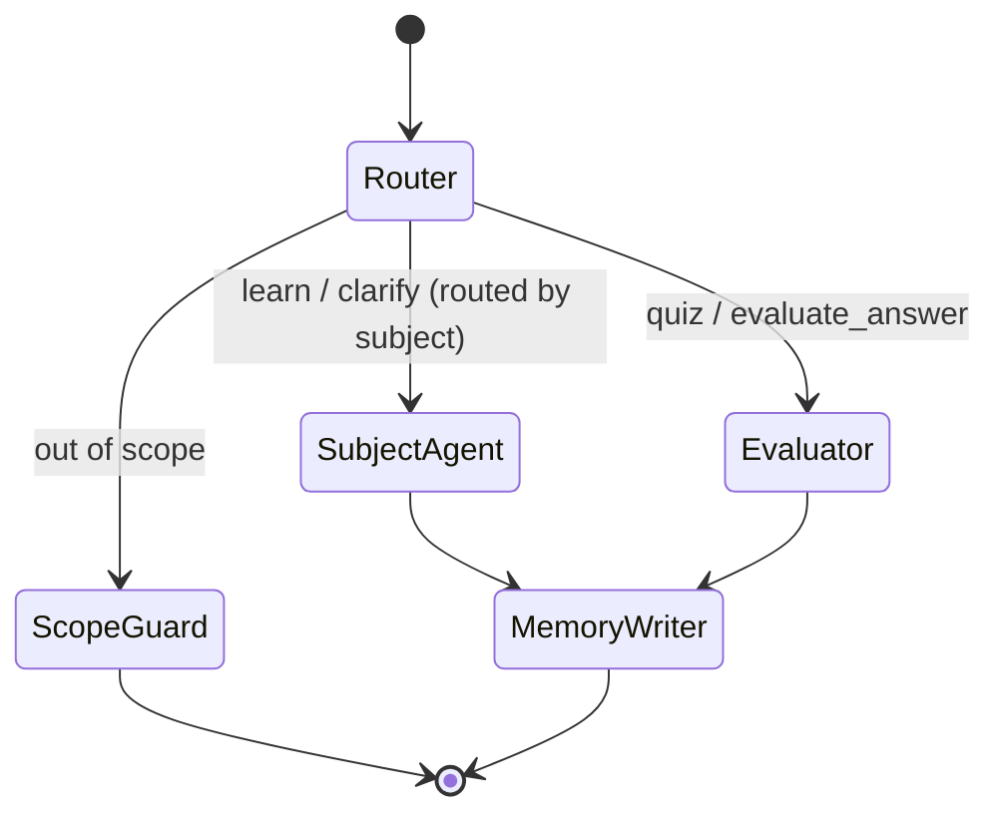

# IntellectA v2.0 — System Architecture

## Vision

Evolve from a linear **Query → LLM → Response** pipeline into a **stateful, multi-agent tutoring platform** with hybrid memory, vector-augmented teaching, and adaptive assessment.

```
┌─────────────────────────────────────────────────────────────────────────────┐
│                           CLIENT (Next.js 14)                               │
│  Chat UI · Quiz UI · Progress Dashboard · Session History                   │
└──────────────────────────────────┬──────────────────────────────────────────┘
                                   │ REST / SSE
                                   ▼
┌─────────────────────────────────────────────────────────────────────────────┐
│                     API GATEWAY (FastAPI — backend)                         │
│  /api/v2/chat · /api/v2/sessions · /api/v2/assessments · /api/v2/health   │
└──────────────────────────────────┬──────────────────────────────────────────┘
                                   │
          ┌────────────────────────┼────────────────────────┐
          ▼                        ▼                        ▼
┌──────────────────┐   ┌──────────────────────┐   ┌──────────────────────┐
│  LangGraph       │   │  Hybrid Memory       │   │  Retrieval Layer     │
│  State Machine   │   │  Layer               │   │  (pgvector)          │
│                  │   │                      │   │                      │
│  Router ─┬─ Prof  │   │  Redis (short-term)  │   │  Hybrid search:      │
│          └─ Eval  │   │  Mem0  (long-term)   │   │  semantic + metadata │
└────────┬─────────┘   └──────────┬───────────┘   └──────────┬───────────┘
         │                        │                          │
         └────────────────────────┼──────────────────────────┘
                                  ▼
                    ┌─────────────────────────────┐
                    │  PostgreSQL + pgvector      │
                    │  users · sessions · messages│
                    │  embeddings · quiz_results  │
                    │  concept_mastery · analytics│
                    └─────────────────────────────┘
```

---

## LangGraph State Machine

### Node Responsibilities

| Node | Trigger | Responsibility |
|------|---------|----------------|
| **Router** | Every turn (entry) | Classify intent + subject + scope |
| **Scope Guard** | `in_scope = false` | Reject non-academic / out-of-subject queries |
| **8 Subject Agents** | `learn`, `clarify` | Dedicated specialist per subject (Math, Physics, …) + **RAG** |
| **Evaluator** | `quiz`, `evaluate_answer` | Generate/adapt questions, score answers |
| **Memory Writer** | After specialist/Evaluator | Persist insights to Mem0 + PostgreSQL |

### Eight Subject Specialist Agents

Each allowed subject has its **own LangGraph node** and **own system prompt** (`src/intellecta/agents/prompts.py`), similar to v1's `MathAgent`, `PhysicsAgent`, etc.:

| Node | Subject | RAG filter |
|------|---------|------------|
| `agent_mathematics` | Mathematics | `documents.subject = mathematics` |
| `agent_physics` | Physics | `physics` |
| `agent_chemistry` | Chemistry | `chemistry` |
| `agent_biology` | Biology | `biology` |
| `agent_history` | History | `history` |
| `agent_politics` | Politics | `politics` |
| `agent_geography` | Geography | `geography` |
| `agent_economics` | Economics | `economics` |

### Graph Flow



### Intent Routing Logic

```
User message
    │
    ▼
Router Node (LLM structured output: intent + subject + in_scope)
    │
    ├─ out of scope                          → Scope Guard
    ├─ "quiz me", answer to quiz             → Evaluator
    └─ learn / clarify + subject=physics     → agent_physics (RAG + specialist prompt)
```

### RAG (Retrieval-Augmented Generation)

| Component | Path | Role |
|-----------|------|------|
| Embeddings | `retrieval/embeddings.py` | FastEmbed `BAAI/bge-small-en-v1.5` (384-dim, local) |
| Vector store | `retrieval/pg_repository.py` | pgvector cosine search + weak-topic boost |
| Curriculum | `retrieval/seed_curriculum.py` | Built-in chunks per subject |
| Seed CLI | `python -m intellecta.scripts.seed_rag` | Insert docs + embeddings into Neon |

**Professor flow per subject agent:**
1. Embed student question
2. Retrieve top-k chunks from `document_chunks` JOIN `documents` (filtered by subject)
3. Boost chunks matching user's weak `concept_mastery` slugs
4. Inject chunks into specialist system prompt → Groq LLM response

---

## Hybrid Memory System

### Short-Term (Redis)

- **Key pattern:** `session:{session_id}:messages`
- **TTL:** 24h (configurable), refreshed on activity
- **Contents:** Last N turns, active quiz state, current difficulty level
- **Purpose:** Real-time graph checkpoint + low-latency context for LLM

### Long-Term (Mem0 + PostgreSQL)

| Store | Data | Example |
|-------|------|---------|
| Mem0 graph | Semantic user facts | "Struggles with AVL left rotation" |
| PostgreSQL `concept_mastery` | Structured mastery scores | `avl_trees.rotation.left = 0.35` |
| PostgreSQL `quiz_results` | Historical attempts | accuracy, latency, difficulty |

**Write path:** Memory Writer node enqueues async job → Mem0 `add()` + upsert `concept_mastery`.

**Read path:** Before Professor/Evaluator runs, fetch Mem0 profile + weak topics → inject into system prompt.

---

## Database (PostgreSQL + pgvector)

Single database for relational + vector data. See `src/intellecta/db/schema.sql`.

**Hybrid query example:**

```sql
-- Retrieve teaching chunks for "AVL trees" scoped to user's weak areas
SELECT dc.content, dc.metadata,
       1 - (dc.embedding <=> $query_embedding) AS similarity
FROM document_chunks dc
JOIN concept_mastery cm ON cm.concept_slug = dc.metadata->>'concept'
WHERE cm.user_id = $user_id AND cm.mastery_score < 0.5
ORDER BY dc.embedding <=> $query_embedding
LIMIT 8;
```

---

## Adaptive Assessment Engine

Difficulty scales on a **1–5 Elo-like scale** per concept:

```
new_difficulty = clamp(
    current + (correct ? +0.3 : -0.5) + latency_factor,
    1.0, 5.0
)

latency_factor:
  response_time < 5s  and correct → +0.2  (too easy)
  response_time > 30s and correct → -0.1  (struggled but got it)
```

See `src/intellecta/assessment/adaptive_engine.py`.

---

## Directory Structure

```
backend/
├── ARCHITECTURE.md          ← this file
├── requirements.txt
├── .env.example
├── pyproject.toml
└── src/intellecta/
    ├── main.py              # FastAPI app factory
    ├── config.py            # Pydantic settings
    ├── api/
    │   ├── deps.py          # DI: DB, Redis, graph
    │   └── routes/
    │       ├── chat.py      # POST /api/v2/chat
    │       ├── health.py
    │       └── sessions.py
    ├── orchestration/
    │   ├── state.py         # TutorState TypedDict
    │   └── graph/
    │       ├── builder.py   # compile LangGraph
    │       ├── routing.py   # conditional edges
    │       └── nodes/
    │           ├── router.py
    │           ├── professor.py
    │           ├── evaluator.py
    │           └── memory_writer.py
    ├── memory/
    │   ├── short_term.py    # Redis session store
    │   └── long_term.py     # Mem0 + PG profile
    ├── retrieval/
    │   └── vector_store.py  # pgvector hybrid search
    ├── assessment/
    │   └── adaptive_engine.py
    ├── db/
    │   ├── schema.sql
    │   └── models.py        # SQLAlchemy models
    └── services/
        └── llm.py           # Groq/OpenAI abstraction
```

---

## API Contract (v2)

### `POST /api/v2/chat`

```json
{
  "session_id": "uuid",
  "message": "Explain AVL tree rotations",
  "mode": "auto"
}
```

Response:

```json
{
  "session_id": "uuid",
  "response": "...",
  "agent": "professor",
  "intent": "learn",
  "metadata": {
    "sources": ["chunk-id-1"],
    "difficulty": null
  }
}
```

---

## Deployment Topology

| Service | Role | Suggested Host |
|---------|------|----------------|
| `backend` | FastAPI + LangGraph | Render / Fly.io |
| PostgreSQL 16 + pgvector | Primary datastore | Neon / Supabase / RDS |
| Redis 7 | Session cache + graph checkpoint | Upstash / ElastiCache |
| Mem0 | Long-term graph memory | Mem0 Cloud or self-hosted |

---

## Migration Path from v1

1. Deploy `backend` alongside existing Flask `backend/`
2. Point frontend to `NEXT_PUBLIC_BACKEND_V2_URL` for new chat route
3. Migrate users from SQLite → PostgreSQL (one-time script)
4. Ingest curriculum content into `document_chunks` with embeddings
5. Deprecate Flask agents once v2 reaches feature parity
